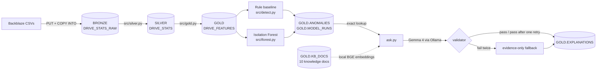

# Drive Health Monitor

A daily-batch telemetry pipeline that loads one quarter of public Backblaze hard-drive SMART data into Snowflake, transforms it with PySpark (Snowpark Connect) through a bronze/silver/gold medallion layout, flags drives behaving abnormally with two detectors, evaluates them honestly against real failure labels, and explains each flag with a small, strictly validated RAG assistant.

- **Data:** Backblaze Drive Stats, Q2 2026: 91 daily CSVs, 31,968,003 rows, 359,101 drives ([source](https://www.backblaze.com/cloud-storage/resources/hard-drive-test-data)).
- **Compute:** Snowflake trial (AWS us-east-2), X-Small warehouse `DRIVE_WH`, auto-suspend 60 s.

## Architecture



### Key Snowflake tables (database `DRIVE_HEALTH`)

| Table | Purpose |
|---|---|
| `BRONZE.DRIVE_STATS_RAW` | every source column as loaded (VARCHAR) plus source file and load timestamp |
| `SILVER.DRIVE_STATS` | typed, deduplicated, the 7 SMART attributes, `failure_within_30d`, `label_is_complete` |
| `GOLD.DRIVE_FEATURES` | per drive per day: 7-day rolling mean, day-over-day delta and same-model z-score for each attribute |
| `GOLD.MODEL_RUNS` | one row per detection run and window: parameters, base rate, precision@k and recall@k |
| `GOLD.ANOMALIES` | top 1000 drives per run: method, score, rank, flagged date, triggers or anomaly score |
| `GOLD.KB_DOCS` | metadata and text of the 10 knowledge documents (no vectors) |
| `GOLD.EXPLANATIONS` | validated explanations: ids, hashes, retrieved and cited doc ids, answer, status |

## Features

- Silver: typed and deduplicated data, a 30-day `failure_within_30d` label (date-based window), and a `label_is_complete` flag so censored labels at the end of the dataset are never mistaken for "healthy". Quality checks fail loudly before anything is written.
- Gold: rolling means, deltas with strict gap handling, and cohort z-scores (same model, same date; detectors ignore cohorts under 30 drives).
- Two detectors, both **label-blind**: labels are joined only after ranking, to compute metrics.
- Two-phase detection writes: both evaluation windows are computed and checked before anything is written.
- Explanation layer with exact per-drive reports, method-aware retrieval and output validation.

## Anomaly detection

| Method | How it works |
|---|---|
| `rule_baseline` | score 0 to 8: for attributes 5, 187, 197 and 198, one point for a same-model z-score above 3 (cohort of at least 30) and one for a day-over-day increase. Ties break on the largest critical z-score. |
| `isolation_forest` | scikit-learn, 21 features (rolling mean, delta, z per attribute), signed log1p, median imputation, trained on non-failure-day rows from April 7 to May 31 with deterministic hash-based drive sampling (cap 200,000). Higher `anomaly_score` means more unusual. No per-feature attribution. |

Evaluation windows: **June 1 to 30 is the official window**, but the dataset ends on June 30, so its labels are censored (no row has a full 30 days ahead). Its precision is a lower bound. **May is a supplemental window with complete labels.** Accuracy is not reported because failures are rare.

| Run | Window | Base rate | P@50 | P@100 | P@500 | R@500 |
|---|---|---|---|---|---|---|
| rule_baseline | June (official, censored) | 0.095% | 0.100 | 0.090 | 0.074 | 0.109 |
| isolation_forest | June (official, censored) | 0.095% | 0.140 | 0.120 | 0.068 | 0.100 |
| rule_baseline | May (supplemental, complete) | 0.241% | 0.340 | 0.270 | 0.170 | 0.099 |
| isolation_forest | May (supplemental, complete) | 0.241% | 0.280 | 0.280 | 0.150 | 0.088 |

Both detectors rank failing drives far above the base rate (roughly 60 to 80 times at k = 500), but absolute precision is modest and recall at 500 is about 10%. The Isolation Forest does not clearly beat the simple rule baseline: it is ahead at the top of the June ranking and behind in May.

## RAG explanation layer

`python -m src.rag.ask "why was drive <serial> flagged?"`

- **Dynamic exact drive report.** The drive's report is built at question time from the persisted anomaly row and telemetry (explicit column allowlist, nothing after the flagged date, structured facts). It is never embedded or retrieved by similarity.
- **Local knowledge embeddings.** 10 hand-written documents (7 SMART attributes, 2 detectors, 1 dataset), each with source metadata, are embedded locally with `BAAI/bge-small-en-v1.5` and cached in `.cache/rag/`. Snowflake is used only for exact lookups, not for vectors.
- **Method-aware retrieval.** Top 3 documents by cosine similarity with a 0.55 floor. For a drive, the document of that run's detector (`method:rule_baseline` or `method:isolation_forest`) is always included and the other detector's document is excluded. General questions use pure semantic retrieval and can abstain.
- **Generation.** Gemma 4 (`gemma4:e4b`) through any OpenAI-compatible endpoint, selected by environment variables.
- **Validation.** Required sections; citations only to supplied ids; every drive number checked against the structured report facts; background sentences must quote or closely paraphrase the cited document; no failure prediction, outcome wording or unsupported causal wording; the Isolation Forest no-attribution statement is required.
- **Retry and fallback.** At most one retry with the error list fed back; if the answer still fails, a deterministic evidence-only answer is stored instead. Models never see or store unvalidated text.
- **Retrieval evaluation** (15 hand-written questions, run once; threshold tuned on a separate 6-question dev set): hit@1 85.7%, hit@3 92.9%, MRR 89.3%, 1 of 1 out-of-scope question correctly abstained.

### Privacy and safety properties

- Failure and evaluation labels are never selected, shown to the LLM or stored; neither new table has such a column.
- A drive report contains no telemetry after the flagged date.
- Only validated answers (or the deterministic fallback) are persisted. `validation_errors` stores attempt numbers and error codes only, never rejected model text.
- Persisted `cited_doc_ids` are canonical ids. `[KNOWLEDGE:<id>]` is accepted only when `<id>` exactly matches a supplied knowledge document.
- Explanations are cached by a hash of question, run, prompt, model, knowledge version, embedding model and report; the insert is skipped if that key already exists.
- Credentials come only from `.env`; the model API key is optional and never logged.

## Setup

Requirements: Python 3.10 to 3.12 (Snowpark Connect does not support 3.13+; the project was built on 3.12), a Snowflake account, and [Ollama](https://ollama.com) for the explanation layer.

```bash
python3.12 -m venv .venv && source .venv/bin/activate
pip install -r requirements.txt
cp .env.example .env        # then fill in your own values
```

Required `.env` variables (see `.env.example`; keep real values out of git):

| Variable | Meaning |
|---|---|
| `SNOWFLAKE_ACCOUNT`, `SNOWFLAKE_USER`, `SNOWFLAKE_PASSWORD`, `SNOWFLAKE_ROLE`, `SNOWFLAKE_WAREHOUSE` | connection |
| `SNOWFLAKE_DATABASE` (`DRIVE_HEALTH`), `SNOWFLAKE_SCHEMA` (default `BRONZE`) | defaults |
| `LLM_PROVIDER` (`openai_compatible`), `LLM_MODEL`, `LLM_BASE_URL` | explanation model |
| `LLM_API_KEY`, `LLM_REASONING_EFFORT` | optional; Ollama needs no key |
| `EMBED_MODEL`, `EMBED_MODEL_REVISION` | optional; defaults to `BAAI/bge-small-en-v1.5` |

### Snowflake setup and load

```bash
snow sql -f sql/00_setup.sql      # warehouse, database, schemas, file format, stage
snow sql -q "PUT 'file:///path/to/data_Q2_2026/*.csv' @DRIVE_HEALTH.BRONZE.RAW_STAGE AUTO_COMPRESS=TRUE PARALLEL=8 OVERWRITE=FALSE"
snow sql -f sql/01_bronze_load.sql  # COPY INTO bronze; verify 31,968,003 rows
```

`GOLD.MODEL_RUNS` and `GOLD.ANOMALIES` are created by the first detection write. `sql/03_anomalies_add_score.sql` and `sql/04_anomalies_widen_method.sql` are migrations for tables created before the Isolation Forest was added (they add `anomaly_score` and widen `method`); on a fresh account they have not been exercised and should not be needed. Create the RAG tables after the detectors have run:

```bash
snow sql -f sql/05_rag_tables.sql             # KB_DOCS and EXPLANATIONS
```

### Pipeline

```bash
python -m src.config                  # connection smoke test
python -m src.silver                  # BRONZE -> SILVER (quality checks first)
python -m src.gold                    # SILVER -> GOLD.DRIVE_FEATURES
python -m src.detect                  # rule baseline, dry run (prints metrics)
python -m src.detect --write          # ...and append to MODEL_RUNS / ANOMALIES
python -m src.iforest --write         # Isolation Forest
```

### Local model (Ollama)

```bash
ollama pull gemma4:e4b
OLLAMA_CONTEXT_LENGTH=8192 ollama serve      # the default 4096 context truncates retries
```

```
LLM_PROVIDER=openai_compatible
LLM_MODEL=gemma4:e4b
LLM_BASE_URL=http://localhost:11434/v1
LLM_REASONING_EFFORT=none                    # Gemma 4 is a thinking model; this keeps the answer within max_tokens (2000)
```

### Knowledge base and questions

```bash
python -m src.rag.build_kb            # validate the 10 documents (dry run)
python -m src.rag.build_kb --write    # upsert into GOLD.KB_DOCS (MERGE on doc_id)
python -m eval.evaluate_rag           # retrieval evaluation

python -m src.rag.ask "why was drive <serial> flagged?" --no-store       # print only, nothing saved
python -m src.rag.ask "why was drive <serial> flagged?" --run <run_id>   # stored; repeats come from the cache
python -m src.rag.ask "what does SMART 197 measure?"                     # general question, knowledge docs only
python -m src.rag.ask "..." --dry-run                                    # show report and system prompt, no model call
```

A drive that appears in several runs gets one explanation per run, official window first. The first call downloads the embedding model.

### Tests

```bash
python -m pytest -q       # offline: no Snowflake, no model server
```

## Project structure

```
sql/        setup, bronze load, anomaly migrations, RAG tables
src/        config, silver, gold, quality, detect (rules), iforest
src/rag/    build_kb, embed, retrieve, report, prompt, llm, validate, ask, knowledge/*.md
eval/       evaluate_rag.py and the question sets
docs/       kb_sources.md (sources for the knowledge documents)
tests/      offline unit tests for every stage
```

## Known limitations

- **Single quarter, censored official window.** June labels are incomplete, so June precision is a lower bound; May is the clean comparison. Results are on one quarter with no repeated runs.
- **Modest detection quality.** About 10% recall at k = 500 and no clear winner between the methods.
- **No scheduling yet.** There are no Snowflake Tasks or `run_pipeline.py`; stages are run by hand in order. The optional Snowflake built-in anomaly comparison is not implemented.
- **Small retrieval evaluation.** 15 questions; the threshold was chosen on only 6 development questions.
- **Validator is strict but not perfect.** A paraphrase of a background document passes with at least 80% content-word overlap, so a short sentence with one invented word could slip through. Drive numbers are checked exactly.
- **Local model variance.** `gemma4:e4b` sometimes needs the one retry, and a poor second attempt falls back to the deterministic answer. Latency is 40 to 90 s per explanation on a laptop.
- **Cortex was unavailable on the trial account**, so embeddings and generation run locally. An `LLM_PROVIDER=cortex` client exists but is untested.
- **Explanations describe observed telemetry and detector output only.** They are not diagnoses and do not predict failure; the Isolation Forest gives no per-feature reasons.
